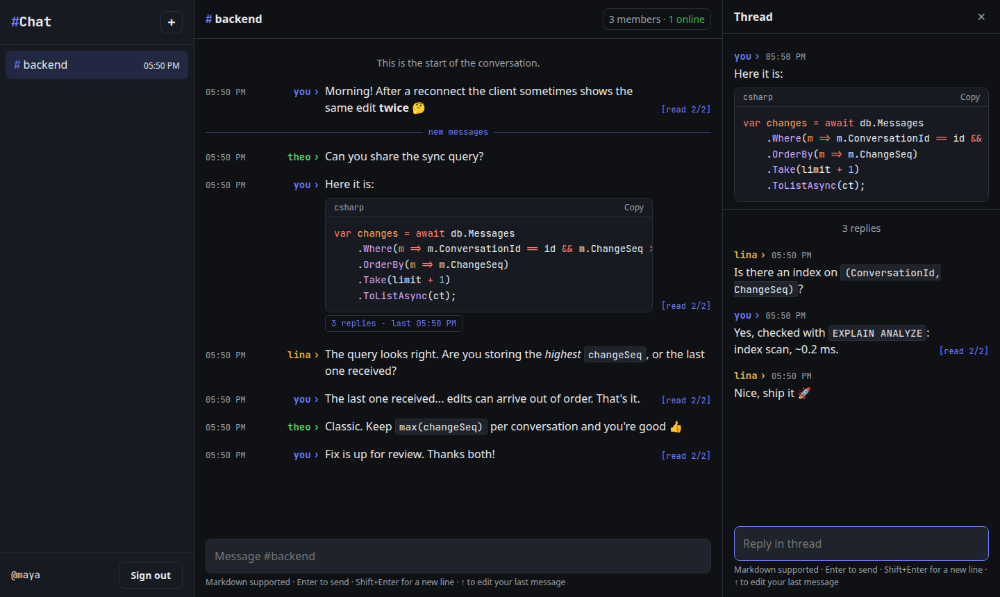
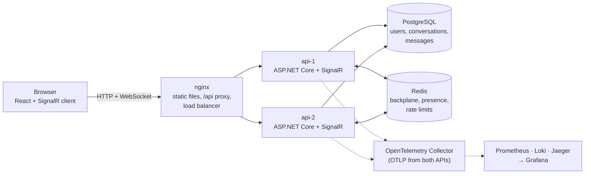
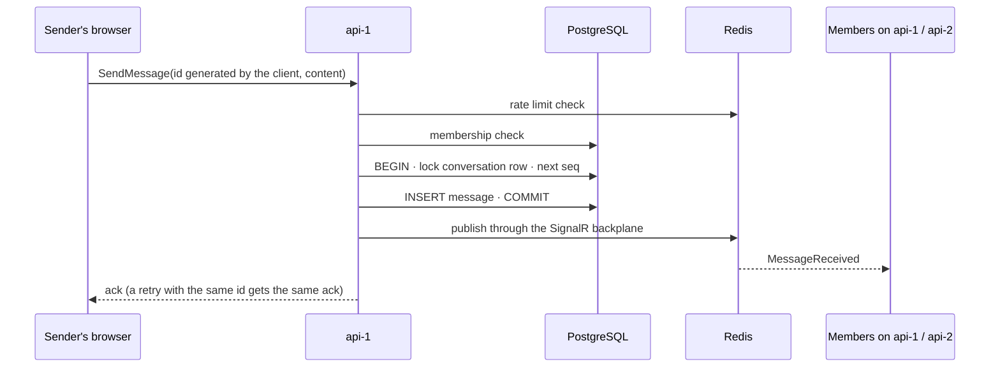
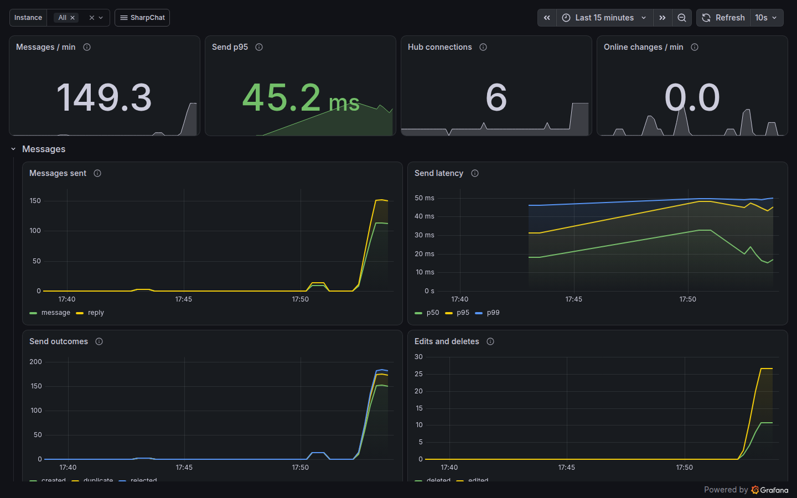

<p align="center">
  
</p>

<h1 align="center">SharpChat</h1>

<p align="center">
  Realtime chat for developers: markdown, highlighted code, threads.<br>
  Built to be reliable first: no lost messages, no duplicates, nothing leaks outside a conversation.
</p>

<p align="center">
  <a href="https://github.com/NepoSales/SharpChat/actions/workflows/ci.yml"></a>
  
  
  <a href="LICENSE"></a>
</p>



## Highlights

- **No lost or duplicated messages.** Clients generate message ids, so retries are idempotent. Every message is stored before it is broadcast. Each conversation has a gap-free sequence assigned under a row lock, so after a reconnect the client asks for "everything after N" and catches up, edits and deletions included.
- **Membership enforced on the server.** Every send, read and realtime event is checked against the database. Non-members get `404`, so they can't even tell a conversation exists. Markdown is sanitized and the frontend runs under a strict Content-Security-Policy.
- **Scales out.** Two API instances run behind nginx without sticky sessions. The SignalR Redis backplane delivers across instances, and presence (Lua scripts) and rate limits live in Redis, so they hold no matter which instance a client lands on.
- **Observable.** OpenTelemetry traces, metrics and logs flow through a Collector into Prometheus, Loki and Jaeger, with three provisioned Grafana dashboards. Logs link to their traces. Adding it surfaced real bugs, a presence leak among them, now fixed and covered by tests.
- **Tested against real infrastructure.** Integration tests use Testcontainers (PostgreSQL, Redis), real SignalR clients and a second API instance. CI runs the backend, frontend and Docker builds on every pull request.

## Features

- Group conversations (up to 100 members) with Owner, Admin and Member roles
- Markdown messages with syntax-highlighted code blocks ([Shiki](https://shiki.style))
- Slack-style threads, editing and deletion
- Delivery and read receipts as terminal tags (`[sent]`, `[delivered 2/3]`, `[read 3/3]`) and unread counters
- Presence, "X is typing…", reconnect banner with automatic resync
- Sessions with short-lived JWTs and a rotating refresh token in an `HttpOnly` cookie

## Architecture



The backend is a modular monolith split into Clean Architecture layers: `Domain` (entities and rules, no dependencies), `Application` (use cases, validation, interfaces), `Infrastructure` (EF Core, Redis, Identity, JWT) and `Api` (controllers, SignalR hub, middleware).

Sending a message, from one instance to members connected anywhere:



## Getting started

Requirements: Docker with Docker Compose.

```bash
cp .env.example .env    # then set JWT_SIGNING_KEY, e.g. openssl rand -base64 48
docker compose up --build
```

Open http://localhost:3000, register two users in two browser windows (one private), create a conversation and start chatting.

To add the observability stack:

```bash
docker compose --profile observability up --build
```

| Service | Address |
|---|---|
| Web app (nginx, balances `/api` over both API instances) | http://localhost:3000 |
| API `api-1`, direct (Swagger, health checks) | http://localhost:8080/swagger, `/health`, `/health/ready` |
| Grafana (no login) · *observability profile* | http://localhost:3001 |
| Jaeger · *observability profile* | http://localhost:16686 |
| Prometheus · *observability profile* | http://localhost:9090 |



## Development

Requirements: .NET 10 SDK, Node 24 and Docker (the integration tests start their own containers).

```bash
# Backend, from backend/
dotnet user-secrets set "Jwt:SigningKey" "$(openssl rand -base64 48)" --project src/SharpChat.Api   # once
docker compose -f ../docker-compose.yml up -d postgres redis
dotnet run --project src/SharpChat.Api

# Frontend, from frontend/
npm install
npm run dev    # http://localhost:5173, proxies /api to http://localhost:8080 (override with SHARPCHAT_API_URL)
```

The browser always talks to the API under `/api` on its own origin: Vite in development and nginx in Docker strip the prefix, upgrade WebSockets and rewrite the refresh cookie path, so no CORS is needed. The JWT signing key is never committed; it comes from user-secrets locally and from `.env` in Docker, and the API refuses to start without it.

Migrations are applied on startup in Development. To add one:

```bash
dotnet tool restore
dotnet ef migrations add <Name> -p src/SharpChat.Infrastructure -s src/SharpChat.Api -o Persistence/Migrations
```

## Testing

```bash
cd backend && dotnet test                                     # unit + integration (Docker required)
cd frontend && npm test                                       # component and unit tests
npm run test:coverage && npm run lint && npm run format:check # what CI runs on the frontend
```

| Suite | What it covers |
|---|---|
| Unit (xUnit) | Domain rules (roles, member limit, thread depth, edit/delete permissions), validation, token handling |
| Integration (xUnit + Testcontainers) | The real API with PostgreSQL and Redis: auth flow and refresh token reuse, membership enforcement, realtime delivery with SignalR clients, idempotent sends, reconnect sync, receipts, threads, a second instance behind the backplane, presence, rate limits, concurrency conflicts, custom metrics |
| Frontend (Vitest + Testing Library) | Markdown sanitization (XSS), message actions and states, receipt tags, cache merging, session refresh, typing throttle |

## Project structure

```
├── backend/
│   ├── src/
│   │   ├── SharpChat.Domain/          # entities and business rules
│   │   ├── SharpChat.Application/     # use cases, validation, interfaces, metrics
│   │   ├── SharpChat.Infrastructure/  # EF Core, repositories, Redis, Identity, JWT
│   │   └── SharpChat.Api/             # controllers, SignalR hub, rate limiting, telemetry
│   └── tests/                         # unit and integration tests
├── frontend/                          # React + TypeScript (Vite), served by nginx
├── observability/                     # Collector, Prometheus, Loki and Grafana config + dashboards
├── docs/API.md                        # REST, SignalR and rate limit reference
└── docker-compose.yml
```

## Documentation

- [docs/API.md](docs/API.md): REST endpoints, SignalR methods and events, rate limits, Swagger.

## License

[MIT](LICENSE)
